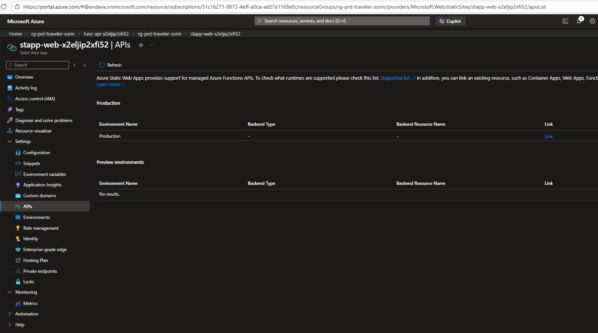
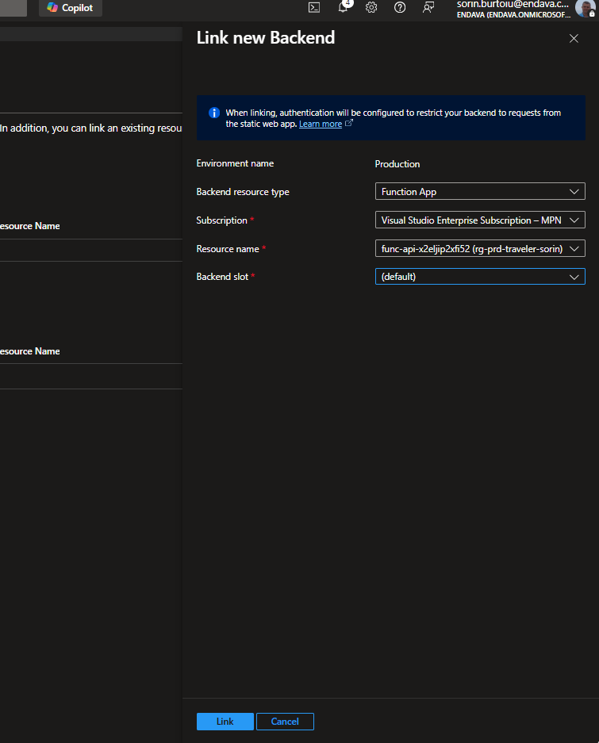

# Link Static Web App with API

This guide explains how to link the deployed Azure Static Web App frontend to the Azure Functions API by using the Azure portal.

After the link is created, requests from the frontend to paths under `/api` are proxied by Azure Static Web Apps to the linked Azure Function App.

## Prerequisites

Before you start, verify the following:

- The Azure Static Web App is already deployed.
- The Azure Function App is already deployed.
- The Static Web App uses the Standard plan. Linking an existing backend is not supported on the Free plan.
- Your Function App exposes HTTP endpoints under the default `/api` prefix.

For this sample, the expected flow is:

- Frontend URL: `https://<your-static-web-app>.azurestaticapps.net`
- Backend URL: `https://<your-function-app>.azurewebsites.net/api/...`

## Link the backend in Azure Portal

1. Open the Azure portal at `https://portal.azure.com`.
2. Open your Azure Static Web App resource.
3. In the left menu, under `Settings`, select `APIs`.
4. In the `Production` row, select `Link`.

5. In the `Link new backend` panel, set these values:

| Setting | Value |
| --- | --- |
| Backend resource type | `Function App` |
| Subscription | The subscription that contains your Function App |
| Resource name | Your deployed Function App |
| Backend slot | `Production` unless you intentionally use another slot |

6. Select `Link`.

When the operation finishes, Azure Static Web Apps starts forwarding requests from `/api/*` to the linked Function App.

## Verify the link

After linking, check the following:

1. In the Static Web App `APIs` page, the `Production` environment should show the linked Function App.
2. Open the frontend site and trigger an action that calls the backend.
3. Confirm that requests are sent to the Static Web App URL under `/api/...`, not directly to `azurewebsites.net`.

Example:

- Frontend call: `https://<your-static-web-app>.azurestaticapps.net/api/StartTravelPlanning`
- Proxied backend target: `https://<your-function-app>.azurewebsites.net/api/StartTravelPlanning`

## Important notes

- Azure Static Web Apps only proxies requests that start with `/api`.
- If you changed the Azure Functions route prefix in `host.json`, the proxy can fail. For this integration, keep the default `api` route prefix.
- A Static Web App can link to only one backend Function App per environment.
- Backend integration is not supported for pull request preview environments.
- When linked, the Function App may be configured so that traffic is expected to come through the Static Web App.

## Troubleshooting

### The `Link` button is missing

Common causes:

- The Static Web App is on the Free plan instead of the Standard plan.
- You are looking at the wrong environment or wrong resource.

### The Function App does not appear in the picker

Check the following:

- The Function App exists in the selected subscription.
- You have permission to view both resources.
- The Function App is publicly reachable and not restricted only through private networking.

### The frontend still cannot call the API after linking

Check the following:

- The frontend is calling `/api/...` and not the direct Function App URL.
- The Function App has HTTP-triggered functions deployed.
- The Function App still uses the `/api` route prefix.
- The function endpoint does not require a function key that the frontend is not sending.

### The browser shows 404 or 500 for `/api/...`

Check the following:

- The function name and route are correct.
- The Function App is healthy and functions are visible in Azure.
- Application settings required by the Function App are present.

## Reference

Microsoft documentation for this setup:

- `Bring your own functions to Azure Static Web Apps`
- `https://learn.microsoft.com/azure/static-web-apps/functions-bring-your-own#link-an-existing-azure-functions-app`